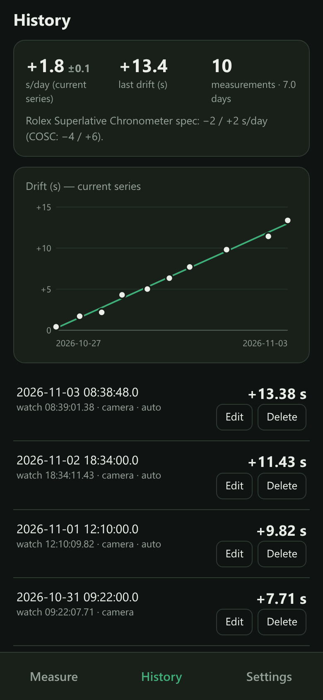
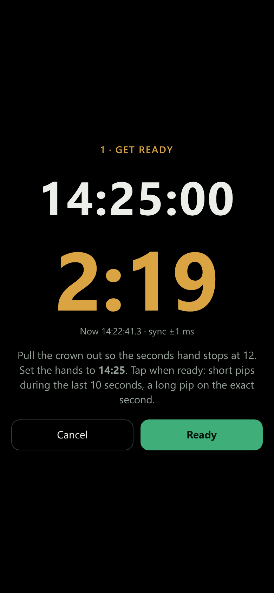
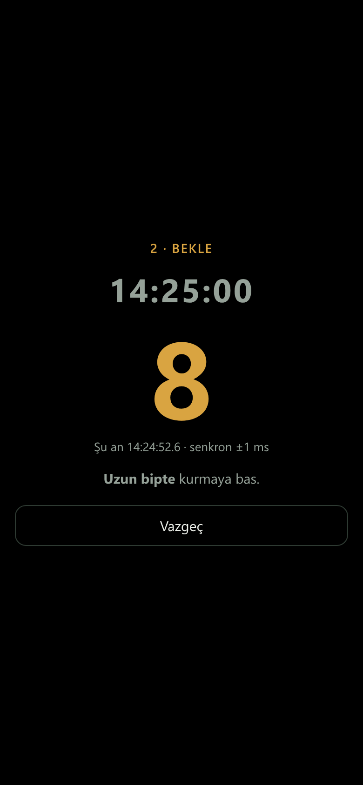
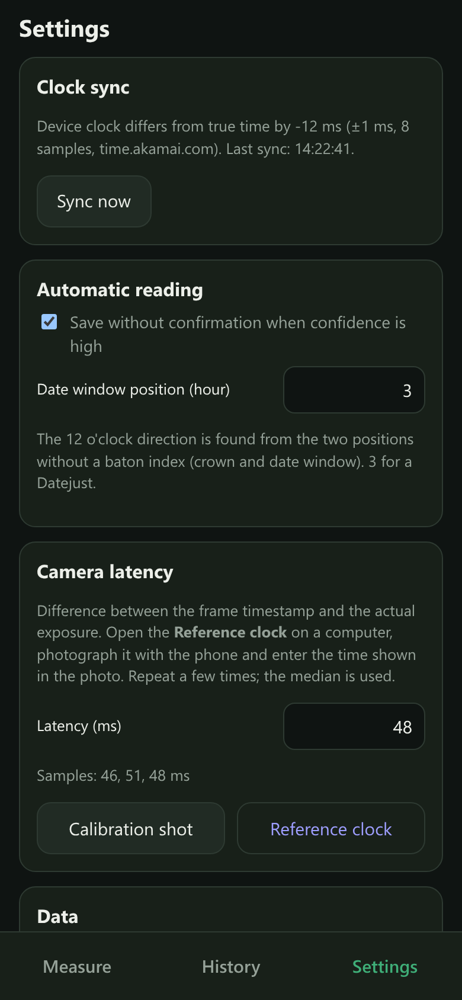

# Watch Logger

A PWA that measures the rate of a mechanical watch (seconds per day). Take a photo of the watch; the app
**reads the dial automatically** with computer vision (hh:mm:ss.ss), compares it with the true capture time
and logs the drift.

**Live:** https://onesvat.github.io/watch-logger/ — open it on your phone and add it to the home screen.

<p>
  
  
  
  
</p>

## Features

- **Automatic reading** of the hour, minute and seconds hands from a photo — no training data.
- **True time**: the device clock is synchronised against `time.akamai.com` (Cristian's algorithm,
  typically ±5–30 ms).
- **Frame time**: the captured frame's timestamp comes from `requestVideoFrameCallback`, corrected by a
  one-off camera latency calibration.
- **Gallery upload**: uses EXIF `DateTimeOriginal + SubSecTimeOriginal + OffsetTimeOriginal`
  (iPhone HEIC included).
- **Rate per series**: linear fit of drift vs. time (s/day ± standard error); setting the watch starts a
  new series.
- **Set the watch**: counts down to the next full 5 minutes. Stop the seconds hand (hack), set the hands,
  tap *Ready*; short pips sound during the last 10 seconds and a long pip at the exact second — push the
  crown in on the long pip. Pips are scheduled on the Web Audio clock, aligned with synced true time.
- Data stays **on the device** (IndexedDB). CSV export/import.

## Automatic reading (`src/cv/`, runs in a Web Worker)

1. **Dial centre** — midpoints of edge pairs with opposite gradients vote for the centre (`center.ts`).
2. **Minute ring** — the affine ellipse that maximises the 60th-harmonic energy of the 60 ticks
   (grid + Nelder–Mead, `ring.ts`).
3. **Perspective** — the inner end of each of the 60 ticks is located at sub-pixel accuracy, then a RANSAC
   homography is fitted over 3 rounds (`dial.ts`; typical RMS 0.4–0.8 px).
4. **12 direction** — phase of the hour indices (30° period) + the two positions without a baton index:
   crown (12) and date (3) (`orient.ts`).
5. **Hour/minute hands** — lume strips, matched against the angles expected from the reference time
   (`hands.ts`).
6. **Seconds hand** — thin-line search in the window predicted by the fractional minute-hand position,
   then a centroid-based TLS line at full resolution (tip + tail). The hand plane is parallel to the dial,
   so under projection it maps to the dial by a homothety — **its direction is unaffected by parallax**.

On 6 sample photos taken within 10 s the drift was −15.24 s with a std of 0.14 s; the fractional seconds
read land within ~±0.05 s of the 1/8 s steps of a 28,800 vph movement. A measurement is never saved without
confirmation: the hour, minute and seconds hands for the time in the input are drawn over the photo (they follow
manual edits), so the reading can be checked against the real hands before tapping *Save*. If the dial is not
found, the hands are drawn on a placeholder dial centred on the photo, starting at true time.

## Development

```sh
pnpm install
pnpm dev      # https://<computer-ip>:5173 — open on the phone and accept the certificate warning
pnpm test     # with sample HEICs + heif-convert + magick present, the end-to-end CV test runs too
RAW=<gray-raw-dir> pnpm exec tsx scripts/cv-eval.ts 1445 1446   # dev: reading report on samples
pnpm build    # dist/ → any static HTTPS host
```

Pushing to `main` runs the tests and deploys to GitHub Pages (`.github/workflows/deploy.yml`).

## Camera latency calibration (once)

1. On a computer, open the app → Settings → **Reference clock**.
2. On the phone, Settings → **Calibration shot** → photograph the screen.
3. Enter the time visible in the photo. Repeat 3–5 times; the median is used.
